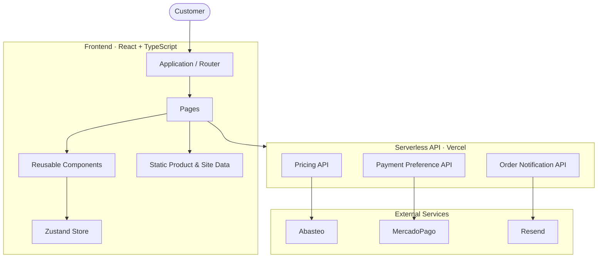
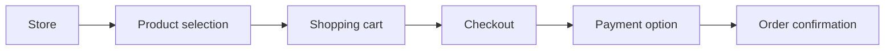
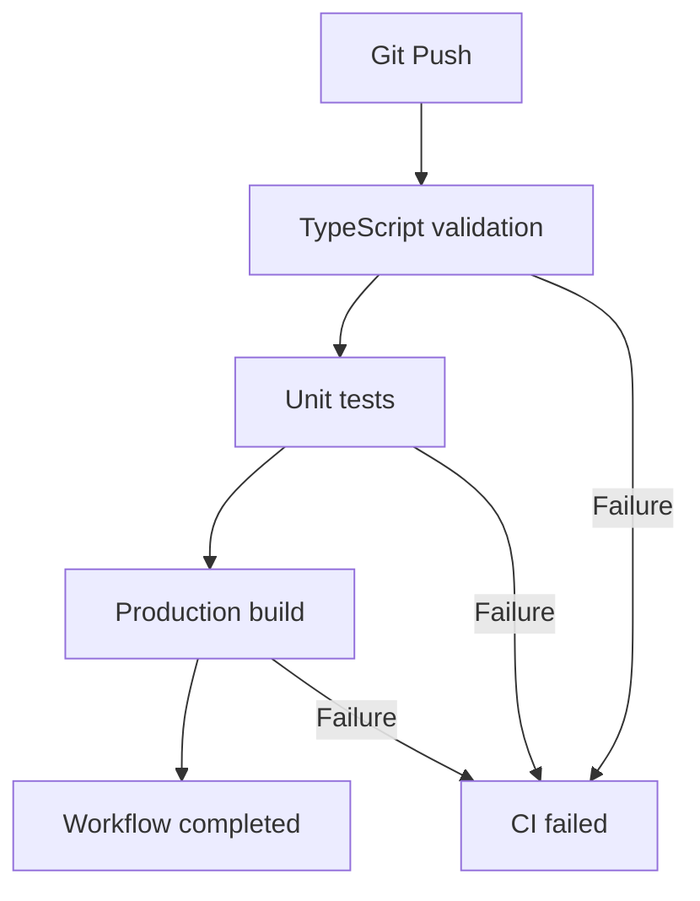

 <div align="center">

<a href="https://github.com/AIXJC">
  
</a>


<br/>

**Official Website · E-commerce Platform · Version 2.0.0**

<br/>

[](https://react.dev/)
[](https://www.typescriptlang.org/)
[](https://vitejs.dev/)
[](https://tailwindcss.com/)
[](https://www.framer.com/motion/)
[](https://zustand.docs.pmnd.rs/)
[](https://vitest.dev/)
[](https://github.com/features/actions)

<br/>

*Technology should feel effortless. Every detail has a purpose.*

</div>

---

## Overview

**SOFTAVISION** is a technology-focused digital platform designed to connect businesses and customers with software solutions, computing products, point-of-sale systems, video surveillance and professional technology services.

The project combines a corporate landing page with an interactive e-commerce experience, bringing together modern frontend technologies, motion design and a modular architecture.

Built with a dark-first visual identity, subtle transitions and a responsive interface, the platform aims to deliver an experience that feels intuitive, elegant and functional.

<div align="center">

**A digital experience built around technology, simplicity and innovation.**

</div>

---

## Product experience

| Module | Description |
|:--|:--|
| Corporate website | Brand presentation, services, projects and contact information |
| Online store | Product catalog with categories, search and filters |
| Shopping cart | Persistent cart with quantity and subtotal management |
| Checkout | Customer information, order summary and payment options |
| Dynamic pricing | Product pricing connected to a supplier data source |
| Customer support | WhatsApp integration and useful resources |

## Features

### Interface & experience

- Animated SVG logo preloader.
- Responsive navigation with mobile menu.
- Smooth page transitions with Framer Motion.
- Scroll-triggered section reveals.
- Parallax effects and animated typography.
- Interactive buttons and hover states.
- Animated counters and technology marquee.
- Custom loading skeletons.
- Floating WhatsApp contact button.
- Custom error handling and fallback page.

### E-commerce

- Product catalog with category filtering.
- Search functionality.
- Individual product detail pages.
- Persistent shopping cart using Zustand.
- Cart drawer with spring animations.
- Quantity management and automatic subtotal calculation.
- Checkout form and order summary.
- Transfer, cash and MercadoPago payment options.
- Animated order confirmation.

### Infrastructure & quality

- TypeScript static type checking.
- Unit testing with Vitest.
- React Testing Library.
- GitHub Actions CI workflow.
- Serverless API functions.
- Dynamic pricing endpoint.
- Basic SEO configuration.
- Responsive mobile-first architecture.

---

## Technology stack

The project uses a modern frontend ecosystem focused on maintainability, performance and user experience.

| Technology | Version | Responsibility |
|:--|:--:|:--|
| React | 18.3 | Component-based UI |
| TypeScript | 5.6 | Static typing |
| Vite | 5.4 | Development and production builds |
| Tailwind CSS | 3.4 | Utility-first styling |
| Framer Motion | 11 | Animations and transitions |
| Zustand | 5.0 | Global state management |
| React Router | 6.28 | SPA navigation |
| Vitest | 3 | Unit testing |
| Testing Library | 16 | Component testing |
| Happy DOM | 15 | DOM testing environment |
| MercadoPago | API | Payment integration |
| Resend | API | Email notifications |

---

## Architecture

The application follows a modular frontend architecture with separate responsibilities for interface components, pages, data, business logic and serverless functions.



### Frontend

The frontend is responsible for rendering the application, handling navigation and providing the customer experience.

**Main technologies:**
- React
- TypeScript
- React Router
- Tailwind CSS
- Framer Motion

### State management

Zustand manages the global shopping cart and its persistence.

The cart state is stored in `localStorage`, allowing the shopping session to survive browser refreshes.

### Serverless API

The `/api` directory contains backend functions intended to handle operations that should not be performed directly in the browser.

- Pricing retrieval.
- MercadoPago payment preference creation.
- Order email notifications.

### Data management

Static product and website information is organized into dedicated files.

This separation makes it easier to maintain the catalog, update content and extend the platform without modifying reusable UI components.

---

## Project structure

```text
softavision-web/
│
├── .github/
│   └── workflows/
│       └── ci.yml
│
├── api/
│   ├── create-preference.ts
│   ├── send-order.ts
│   ├── precios.ts
│   └── precios-proveedor.json
│
├── public/
│   ├── favicon.svg
│   ├── robots.txt
│   └── sitemap.xml
│
├── src/
│   ├── components/
│   │   ├── Navbar.tsx
│   │   ├── Footer.tsx
│   │   ├── Hero.tsx
│   │   ├── ProductCard.tsx
│   │   ├── CartDrawer.tsx
│   │   ├── WhatsAppButton.tsx
│   │   ├── ErrorBoundary.tsx
│   │   ├── Skeleton.tsx
│   │   └── ...
│   │
│   ├── pages/
│   │   ├── HomePage.tsx
│   │   ├── StorePage.tsx
│   │   ├── Productpage.tsx
│   │   ├── CartPage.tsx
│   │   ├── CheckoutPage.tsx
│   │   ├── SupportPage.tsx
│   │   ├── LegalPage.tsx
│   │   └── NotFoundPage.tsx
│   │
│   ├── data/
│   │   ├── products.ts
│   │   ├── resources.ts
│   │   └── site.ts
│   │
│   ├── lib/
│   │   ├── constants.ts
│   │   ├── utils.ts
│   │   └── payments.ts
│   │
│   ├── store/
│   │   ├── carts.ts
│   │   └── ui.ts
│   │
│   ├── __tests__/
│   │   ├── setup.ts
│   │   ├── utils.test.ts
│   │   └── cart.test.tsx
│   │
│   ├── assets/
│   │   └── products/
│   │
│   ├── App.tsx
│   ├── main.tsx
│   └── index.css
│
├── assets/
│   └── aigc/
│       └── images/
│
├── index.html
├── package.json
├── vite.config.ts
├── vitest.config.ts
├── tsconfig.json
├── tailwind.config.js
├── postcss.config.js
└── .gitignore
```

---

## Getting started

### Requirements

Make sure you have installed:

- [Node.js](https://nodejs.org/) 18 or higher.
- npm.
- Git.

### Installation

Clone the repository:

```bash
git clone https://github.com/AIXJC/Sitio-Web-Softavision-2.git
```

Enter the project directory:

```bash
cd Sitio-Web-Softavision-2
```

Install dependencies:

```bash
npm install
```

Start the development server:

```bash
npm run dev
```

Open your browser:

```text
http://localhost:5173
```

### Local network access

Vite is configured to expose the development server on the local network.

To access the application from another device connected to the same Wi-Fi:

```text
http://YOUR_LOCAL_IP:5173
```

On Windows, find your local IP address using:

```powershell
ipconfig
```

If necessary, allow the development port through Windows Firewall:

```powershell
New-NetFirewallRule `
  -DisplayName "Vite Dev 5173" `
  -Direction Inbound `
  -Protocol TCP `
  -LocalPort 5173 `
  -Action Allow
```

---

## Available scripts

| Command | Description |
|:--|:--|
| `npm run dev` | Starts the Vite development server |
| `npm run build` | Validates TypeScript and creates the production build |
| `npm run preview` | Previews the production build |
| `npm run typecheck` | Runs TypeScript validation |
| `npm test` | Runs Vitest in watch mode |
| `npm test -- --run` | Executes tests once |

---

## Environment configuration

Some integrations require external credentials.

Create a local environment file:

```bash
cp .env.example .env
```

Configure the credentials required by your integrations.

| Variable | Purpose |
|:--|:--|
| `MERCADOPAGO_ACCESS_TOKEN` | MercadoPago server-side authentication |
| `RESEND_API_KEY` | Email delivery through Resend |

> **Security:** Never commit `.env` files, API keys, access tokens or private credentials to GitHub. Configure production secrets through your hosting provider.

The `.env.example` file should contain variable names and placeholders only.

---

## API reference

The serverless functions are located inside the `api/` directory.

| Endpoint | File | Responsibility |
|:--|:--|:--|
| `/api/precios` | `precios.ts` | Retrieves supplier pricing information |
| `/api/create-preference` | `create-preference.ts` | Creates a MercadoPago payment preference |
| `/api/send-order` | `send-order.ts` | Sends order notifications by email |

### Dynamic pricing

The pricing system retrieves supplier prices from the configured data source and applies the business margin.

The margin must be applied only once to avoid duplicated price adjustments.

The frontend should consume the final calculated price instead of applying the same margin again.

### Payment processing

MercadoPago integration uses a server-side preference creation function.

The access token must remain on the server and must never be exposed in frontend code.

Transfer and cash options are informational payment methods and should not be confused with an automatically processed online transaction.

---

## Application routes

| Route | Component | Description |
|:--|:--|:--|
| `/` | `HomePage` | Corporate landing page |
| `/tienda` | `StorePage` | Product catalog |
| `/producto/:slug` | `Productpage` | Product details |
| `/carrito` | `CartPage` | Shopping cart |
| `/checkout` | `CheckoutPage` | Checkout process |
| `/legal` | `LegalPage` | Privacy and legal information |
| `*` | `NotFoundPage` | Unknown routes / 404 fallback |

---

## State management

The shopping cart is managed using Zustand with persistence middleware.

**Store:** `src/store/carts.ts`

| Action | Responsibility |
|:--|:--|
| `add(product, qty)` | Adds or increments a product |
| `remove(id)` | Removes a product |
| `setQty(id, qty)` | Updates product quantity |
| `clear()` | Clears the shopping cart |

Additional selectors:

```ts
selectCount(items)
selectTotal(items)
```

The cart persistence key is:

```text
softavision-cart
```

### Shopping flow



---

## Motion & interaction design

SOFTAVISION uses Framer Motion and custom CSS animations to create a more engaging and responsive experience.

The animation philosophy prioritizes subtlety, continuity and functionality.

| Effect | Component | Implementation |
|:--|:--|:--|
| SVG logo drawing | Preloader | `motion.path` + `pathLength` |
| Animated typography | Hero | `useEffect` + `motion.span` |
| Scroll parallax | Hero | `useScroll` + `useTransform` |
| Section reveals | Reveal | `whileInView` |
| Animated counters | BusinessSection | `useMotionValue` + `useSpring` |
| Product scan effect | ProductCard | Custom CSS keyframes |
| Animated filtering | StorePage | `AnimatePresence` |
| Navigation transitions | Navbar | `layoutId` |
| Shopping cart drawer | CartDrawer | Spring transitions |
| Infinite marquee | TechStack | CSS keyframes |
| Floating contact pulse | WhatsAppButton | `pulse-ring` |

### Design principles

- Smooth transitions instead of abrupt changes.
- Consistent motion timing.
- Minimal visual distractions.
- Responsive interactions across devices.
- Clear visual hierarchy.
- Respect for reduced-motion preferences.

---

## Visual identity

The platform uses a dark-first visual system inspired by modern software interfaces.

| Design token | Value | Purpose |
|:--|:--|:--|
| `ink` | `#050D22` | Primary background |
| `brand` | `#1E5EFF` | Primary brand blue |
| `sky` | `#35C8F0` | Cyan accent |
 
### Interface guidelines

- Dark backgrounds with controlled contrast.
- Blue accents for important interactions.
- Subtle gradients and lighting.
- Clean typography and generous spacing.
- Glass-inspired surfaces used selectively.
- Consistent component behavior.

The objective is to maintain a recognizable brand identity without sacrificing usability.

---

## Testing & quality assurance

The project includes unit and component tests using Vitest and Testing Library.

### Current test files

| File | Coverage |
|:--|:--|
| `utils.test.ts` | Price formatting, margin calculation, slug generation and class utilities |
| `cart.test.tsx` | Shopping cart operations and state management |

Run the tests:

```bash
# Watch mode
npm test

# Single execution
npm test -- --run
```

Validate TypeScript:

```bash
npm run typecheck
```

Create a production build:

```bash
npm run build
```

---

## Continuous integration

GitHub Actions provides an automated validation workflow.

**Workflow:** `.github/workflows/ci.yml`

The pipeline executes on pushes to `master` or `main` and validates:



### Pipeline commands

```bash
npm run typecheck
npm test -- --run
npm run build
```

This helps identify type errors, test failures and production build issues before deployment.

---

## Deployment

The application generates a production build in the `dist/` directory.

Build the project:

```bash
npm run build
```

Preview the production version:

```bash
npm run preview
```

### Supported deployment options

| Platform | Configuration |
|:--|:--|
| [Vercel](https://vercel.com/) | Build: `npm run build` · Output: `dist` |
| [Netlify](https://www.netlify.com/) | Build: `npm run build` · Output: `dist` |
| GitHub Pages | Configure the Vite `base` path |
| Traditional hosting | Upload the contents of `dist/` |

> **Important:** The frontend is a SPA, but the project also contains serverless API functions. Hosting only the static `dist/` directory will not deploy those backend functions. Use a compatible serverless deployment or configure the API separately.

For SPA hosting, configure route fallback behavior so direct navigation to application routes resolves correctly.

Remember to update the canonical domain in `public/sitemap.xml` before production deployment.

---

## Customization

The following files control the main application settings.

| What to modify | Location |
|:--|:--|
| Brand colors | `tailwind.config.js` |
| Brand information | `src/lib/constants.ts` |
| Contact details | `src/lib/constants.ts` |
| WhatsApp configuration | `src/lib/constants.ts` |
| Navigation links | `src/lib/constants.ts` |
| Product catalog | `src/data/products.ts` |
| Website content | `src/data/site.ts` |
| Recommended resources | `src/data/resources.ts` |
| Legal content | `src/pages/LegalPage.tsx` |
| SEO metadata | `index.html` |

### Adding a product

1. Open `src/data/products.ts`.
2. Duplicate an existing product object.
3. Assign a unique `id`.
4. Define a unique `slug`.
5. Add the product name, category, description and price.
6. Add the image to `src/assets/products/`.
7. Import the image and reference it in the product object.

---

## Development roadmap

The following items represent potential future improvements, not necessarily implemented functionality.

- [ ] Customer accounts and authentication.
- [ ] Order history and customer dashboard.
- [ ] Administrative product management.
- [ ] Real-time inventory synchronization.
- [ ] Expanded payment processing.
- [ ] Advanced product search.
- [ ] Improved analytics and conversion tracking.
- [ ] Additional automated testing.
- [ ] Accessibility improvements.
- [ ] Performance monitoring.

---

## Project notes

- Product prices in the static catalog may contain demonstration values and should be verified before commercial use.
- Dynamic pricing depends on the configured supplier data source.
- MercadoPago requires valid production credentials.
- Email notifications require a configured Resend account.
- Transfer and cash payments require an appropriate manual order confirmation process.
- Social media URLs and contact information should be reviewed before deployment.
- Production integrations must be tested independently before accepting real customer orders.

---

## License

**All rights reserved © SOFTAVISION.**

This repository contains proprietary project materials and software developed for SOFTAVISION.

No redistribution, reproduction or commercial use is authorized without prior written permission from the copyright holder.

---

<div align="center">


<br/>

**SOFTAVISION**

*Digital solutions. Designed with purpose.*

<br/>

Developed by **Alexander Juarez** 🇲🇽

[GitHub](https://github.com/AIXJC) · [Repository](https://github.com/AIXJC/Sitio-Web-Softavision-2)

<br/>

<sub>React · TypeScript · Vite · Tailwind CSS · Framer Motion · Zustand</sub>

<br/>


</div>
